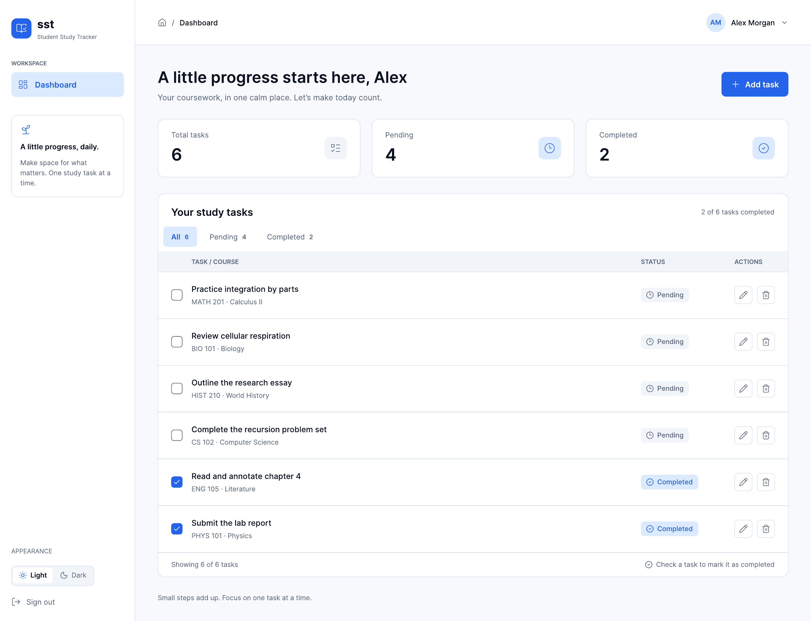
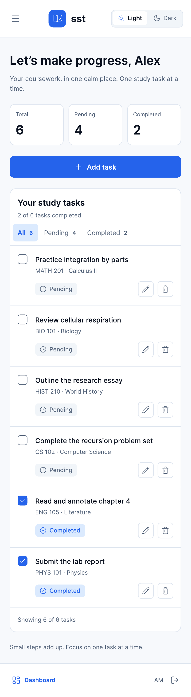

# Student Study Tracker (SST)

**A calmer place to organize coursework, track progress, and keep study tasks moving.**

SST is a responsive study-task tracker built with Vite, vanilla JavaScript, Firebase Authentication, and Cloud Firestore for the ATU Virtual Internship mini project.

  

<em>Desktop dashboard preview · Task counts, course filters, pending and completed tasks, and task actions.</em>

## Run locally

1. Install Node.js and npm.
2. Run `npm install`.
3. Copy `.env.example` to `.env` and fill in the Firebase Web app configuration values.
4. Run `npm run dev` and open the Local URL printed by Vite (usually `http://localhost:5173`). Keep the terminal running while testing the app.

See [COMMANDS.md](COMMANDS.md) for the project command reference and what each command is used for.

The required values are `VITE_FIREBASE_API_KEY`, `VITE_FIREBASE_AUTH_DOMAIN`, `VITE_FIREBASE_PROJECT_ID`, `VITE_FIREBASE_STORAGE_BUCKET`, `VITE_FIREBASE_MESSAGING_SENDER_ID`, and `VITE_FIREBASE_APP_ID`. Create a Firebase project and Web app in the Firebase Console to obtain them. Enable Email/Password and Google providers in Authentication when implementing the authentication phase.

## Current implementation

The app includes Firebase email/password registration and login, Google sign-in, password reset email requests, restored authentication state, and sign-out. Signed-in users can create, view, edit, complete or reopen, and delete their own study tasks in Firestore. The responsive dashboard includes task counts, status filters, pagination with up to 10 tasks per page, helpful empty states, loading/retry/error feedback, and Coastal Blue light and dark themes. Firestore rules validate task fields and restrict access to the signed-in user's `users/{userId}/tasks` path.

Run `npm run test:rules` to execute the Firestore security tests against the local emulator. This uses a demo project ID and does not connect to production. The emulator requires Java 11 or newer and the Firebase CLI. Use `npm run build` to create the Firebase Hosting files in `dist/`.

See [TESTING.md](TESTING.md) for the latest test results and the owner review checklist before publishing.

## Mobile preview

  

<em>The dashboard adapts to a phone-sized screen while keeping task status and actions visible.</em>

These images are design previews from the repository's UI references. The running app may differ slightly as implementation evolves.

In the Firebase Console, enable Email/Password and Google sign-in under Authentication. For local Google sign-in, make sure `localhost` is in Authentication's authorized domains. After reviewing `firestore.rules`, deploy it with `firebase deploy --only firestore:rules --project sstv1-e6dc0`. See [COMMANDS.md](COMMANDS.md) for the command reference.
